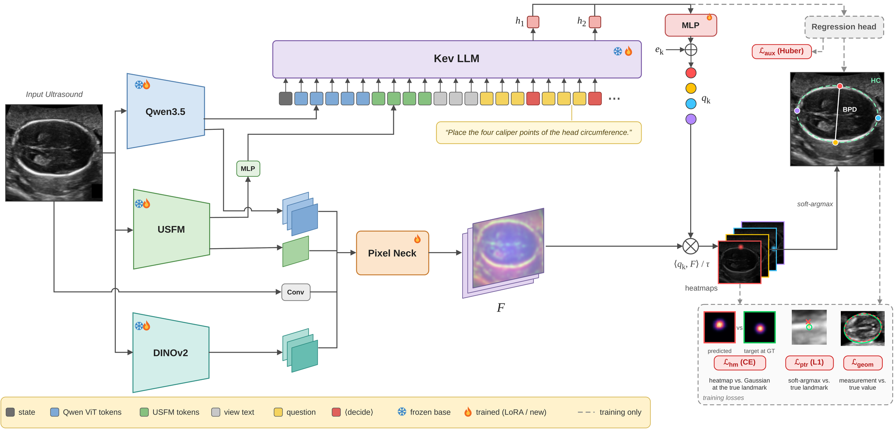
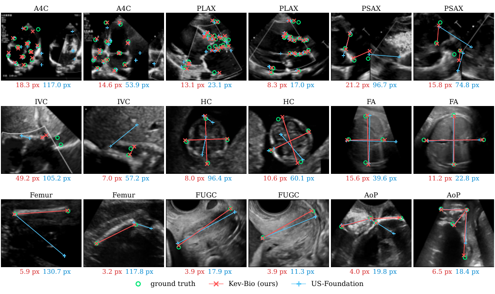

# Every Pixel Is an Option: A System One Model for Medical Ultrasound Biometry

[](https://arxiv.org/abs/2611.03360)
[](https://moeinheidari7829.github.io/every-pixel/)



**Kev-Bio** poses each clinical measurement as a question to a vision-language model initialised from
[Kev](https://huggingface.co/jaredpalmer/kev-0.8b) (Qwen3.5-0.8B). The decision state of each question produces one
query per caliper endpoint. Each query is matched against a dense pixel map fused from Qwen3.5, USFM and DINOv2
features, giving a probability map per landmark. A single model covers all nine views and 29 measurements of
FU/GU Biometry 2026.

| 5-fold CV, FU/GU Biometry 2026 | MRE (px) ↓ | MAE ↓ |
|---|---|---|
| nnLandmark | 28.73 ± 4.12 | 22.37 ± 1.47 |
| CAMS | 23.88 ± 2.10 | 18.58 ± 1.28 |
| FMUB | 24.98 ± 3.41 | 17.47 ± 0.90 |
| US-Foundation | 25.85 ± 2.87 | 18.97 ± 1.41 |
| **Kev-Bio** | **22.50 ± 2.10** | **15.38 ± 1.24** |


<sub>Kev-Bio (red) and US-Foundation (blue) against the ground truth (green); values are the mean landmark error.</sub>

## Installation

```bash
conda create -n kevbio python=3.12 -y && conda activate kevbio
pip install torch==2.8.0 --index-url https://download.pytorch.org/whl/cu126
pip install -r requirements.txt
```

Qwen3.5-0.8B, the Kev adapter and DINOv2 ViT-L/14 are downloaded automatically on first use. The USFM weights
(`USFM_latest.pth`) are available from [openmedlab/USFM](https://github.com/openmedlab/USFM). Place them at
`weights/USFM_latest.pth`, or set `USFM_WEIGHTS=/path/to/USFM_latest.pth`.

## Data

We use the labelled training set of the
[FU/GU Biometry 2026 challenge](https://doi.org/10.5281/zenodo.19736827) (MICCAI 2026). The data cannot be
redistributed; please obtain it from the challenge organisers. Then run:

```bash
python scripts/prepare_data.py --raw /path/to/challenge_download --out data
```

This writes `data/fold{0..4}/{train,val}.jsonl` for the five-fold split in [`splits/`](splits/kfold_group_v1).

## Training and evaluation

```bash
for k in 0 1 2 3 4; do scripts/run_fold.sh $k; done
python scripts/evaluate.py --pred "runs/fold{k}/kevbio/predictions.json"
```

## Citation

```bibtex
@article{heidari2026every,
  title   = {Every Pixel Is an Option: A System One Model for Medical Ultrasound Biometry},
  author  = {Heidari, Moein and Rao, Junbo and Chen, Yudan and Medghalchi, Yasamin and Jiang, River and
             Chen, Wenjin and Foran, David J. and Grewal, Jasmine and Hacihaliloglu, Ilker},
  journal = {arXiv preprint arXiv:2611.03360},
  year    = {2026}
}
```

## Acknowledgements

This code builds on [Kev](https://huggingface.co/jaredpalmer/kev-0.8b), [Qwen3.5](https://huggingface.co/Qwen),
[USFM](https://github.com/openmedlab/USFM) and [DINOv2](https://github.com/facebookresearch/dinov2). The augmentation
and the FA/HC projection are adapted from [fubiometry2026](https://github.com/harshitAgr/fubiometry2026) (Apache-2.0).
The metric follows [US-Foundation](https://github.com/abarmper/US-Foundation). `kevbio/usfm_vit.py` is from USFM and
is licensed under CC BY-NC 4.0.
